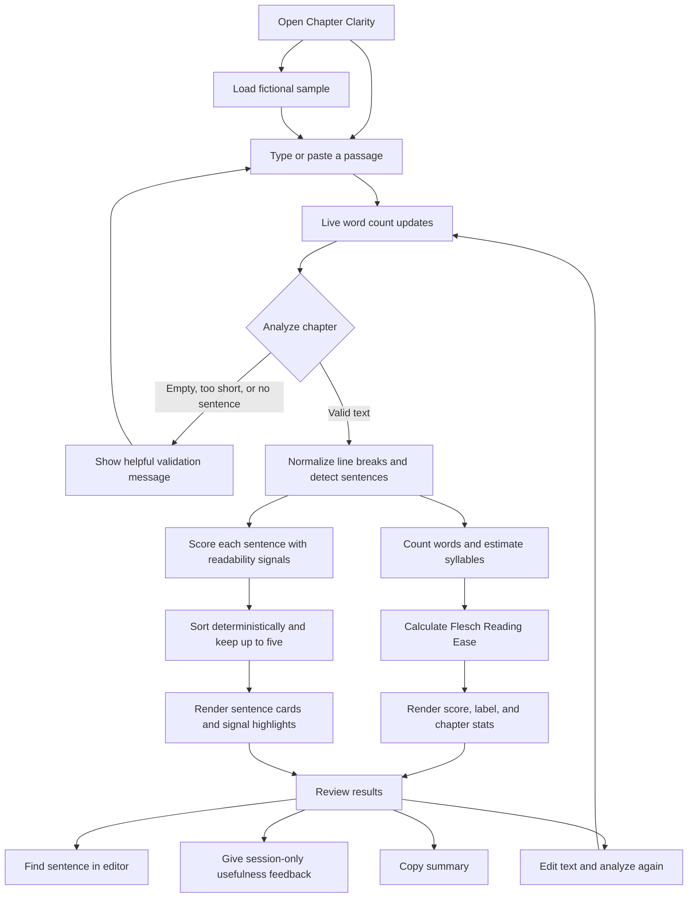

# Chapter Clarity

**Make every sentence easier to follow.**

Chapter Clarity is a free, browser-based first-pass readability tool for authors and editors. Paste a chapter, scene, or short passage to get an estimated Flesch Reading Ease score and up to five sentences that may deserve a second look. The suggestions are based on transparent text signals; the author stays in charge of every edit.

> **Project status:** The MVP is implemented as a static website. It has not yet been deployed publicly or validated with external users. Do not present a live URL, user count, or user feedback as fact until those things have actually happened.

## Contents

- [Why this exists](#why-this-exists)
- [Features](#features)
- [Using the app](#using-the-app)
- [User flow](#user-flow)
- [How analysis works](#how-analysis-works)
- [Privacy and data handling](#privacy-and-data-handling)
- [Technology](#technology)
- [Run locally](#run-locally)
- [Deploy](#deploy)
- [Accessibility and responsive behavior](#accessibility-and-responsive-behavior)
- [Limitations](#limitations)
- [AI-assisted development](#ai-assisted-development)
- [Validation checklist](#validation-checklist)
- [Plan for the first 100 users](#plan-for-the-first-100-users)
- [Project files](#project-files)

## Why this exists

Authors can know what they intend to say and still have trouble spotting where a reader might need to slow down. Long sentences, unfamiliar words, clause-heavy phrasing, and punctuation can all make prose harder to process. Chapter Clarity gives writers a quick, private starting point for reviewing those passages.

The product is intentionally small: no account, no manuscript upload, no AI rewriting, and no claim that a formula can judge literary quality. It offers a reading estimate and points to sentences using visible, explainable heuristics.

## Features

- Paste or type up to 100,000 characters.
- See a live word count and clear the editor at any time.
- Load a fictional sample passage to try the tool.
- Calculate a Flesch Reading Ease estimate and a plain-language difficulty label.
- See total words, detected sentences, and estimated reading minutes.
- Review up to five higher-scoring sentences, each with a word count and explanation.
- See longer-word, clause, and punctuation signals highlighted in each result.
- Use **Find in chapter** to return to and select the sentence in the editor. The selection uses a warm yellow-orange color.
- Mark suggestions useful or not useful. Votes are kept only in page memory for the current session.
- Copy a plain-text summary of the score and flagged sentences.
- Use `Ctrl+Enter` (Windows/Linux) or `⌘+Enter` (Mac) to analyze.
- Read how the score and sentence ranking are calculated in the expandable method section.

## Using the app

1. Paste a chapter or choose **Try a sample**.
2. Select **Read my chapter**, or use the keyboard shortcut.
3. Review the score, label, word count, sentence count, and reading-time estimate.
4. Read the suggested sentences and the signals that caused them to rank highly.
5. Choose **Find in chapter** to select a sentence in the editor, then decide whether it needs a revision.
6. Optionally mark a suggestion useful or not useful, copy the summary, or edit the passage and analyze again.

The product does not rewrite sentences. Its purpose is to help an author decide where to focus.

## User flow



## How analysis works

All analysis runs in `app.js` in the user's browser.

### Word count

The app counts Unicode letters and numbers, including common contractions such as `don't` and `writer’s`, as words. This is a practical counter rather than a publisher's or word processor's formal word-count standard.

### Sentence detection

The sentence splitter accounts for common titles and abbreviations (for example `Dr.` and `etc.`), initials, dotted acronyms, decimal numbers, ellipses, closing quotation marks, and common terminal punctuation (`.`, `!`, `?`). It is still a small rule-based parser. Some abbreviations can also be complete words or sentence endings, and dialogue or deliberately fragmented fiction can remain ambiguous.

### Syllable estimate

Syllables are estimated with English vowel-group patterns and simple silent-ending rules. It does not use a pronunciation dictionary. Proper names, borrowed words, unusual spellings, and dialect can therefore be counted incorrectly.

### Flesch Reading Ease

The score is calculated as:

```text
206.835 − 1.015 × (words / sentences) − 84.6 × (estimated syllables / words)
```

The result is rounded for display and clamped to 0–100. Higher scores generally indicate easier-to-read English prose. The accompanying label uses common Flesch Reading Ease bands. The number is an estimate, not a grade, a comprehension test, or a measure of literary quality.

### Sentence ranking

Each detected sentence receives this heuristic score:

```text
0.7 × word count
+ 9 × average estimated syllables per word
+ 2 × selected punctuation count
+ 4 × detected clause-marker count
```

Selected punctuation includes semicolons, commas, em dashes, colons, and parentheses. Clause markers include words such as *although*, *because*, *which*, *if*, and *while*. The app sorts highest score first, then higher word count, then sentence text for deterministic tie-breaking. It shows at most five sentences; passages with fewer sentences show fewer results.

These coefficients are practical initial choices, not scientifically validated weights. A long sentence can be easy to read, and a short sentence can be confusing. The displayed explanations describe signals, not certainty about reader experience.

### Highlighting and finding a sentence

In each result card, the app highlights estimated longer words (three or more estimated syllables), detected clause markers, and selected punctuation. **Find in chapter** searches the editor text for the selected sentence and uses the textarea's text selection to bring it into view. Editing the passage after the analysis can make an old result no longer match; analyze again to refresh the results.

## Privacy and data handling

- Chapter text is processed locally by the page's JavaScript.
- The app has no backend, accounts, manuscript database, or analytics in this version.
- Chapter text and usefulness votes are not sent to a server or persisted by the app.
- The sample passage is fictional and included in the source code.
- The page references Google Fonts for typography. A browser may make ordinary font requests to Google when online; those requests do not include the chapter text. Remove the Google Fonts links in `index.html` for an offline-only font setup.
- The feedback link opens the user's email application with a prefilled subject; it does not submit feedback automatically.

## Technology

| Part | Implementation |
| --- | --- |
| Interface | Semantic HTML in `index.html` |
| Styling | Plain CSS in `styles.css`, including responsive and reduced-motion rules |
| Readability analysis | Plain JavaScript in `app.js` |
| Runtime | Modern browser; no build step or package installation |
| Storage and server | None required for analysis |

There are no frameworks, API keys, paid services, or server-side dependencies in the MVP.

## Run locally

### Simplest option

Open `index.html` in a modern browser. Internet access is only needed for the optional Google Fonts; system fonts are used as fallbacks.

### Local static server

From the project directory, run one of the following if Python is installed:

```bash
python -m http.server 8000
```

Then open [http://localhost:8000](http://localhost:8000). You can also use any simple static-file server.

## Deploy

The app can be hosted on any static host because it does not need a backend or build step. For example:

1. Put `index.html`, `styles.css`, `app.js`, and `README.md` in a Git repository.
2. Create a static-site project with a provider such as GitHub Pages or Netlify.
3. Set the published directory to the repository root; there is no build command.
4. Open the resulting public URL in a fresh private/incognito browser session.
5. Try the sample, analyze a passage, use **Find in chapter**, check a phone-sized viewport, and confirm the address is publicly reachable.
6. Only then add the verified URL to an application or screening response.

Hosting providers may change their setup steps and free-tier limits. Check the provider's current documentation when deploying.

## Accessibility and responsive behavior

- The page uses semantic headings, labels, buttons, lists, and an announced word count.
- The editor is keyboard-operable, has a visible focus treatment, and supports the analyze shortcut.
- Validation messages use an alert role, and the results region is announced politely.
- Focus-visible styles are provided for key controls.
- Reduced-motion preferences are respected.
- The layout adapts to mobile widths; the text editor keeps a readable 16px input size on small screens.

## Limitations

- The readability formula is intended as a rough estimate for English text; it may not represent a particular reader or audience.
- Syllable counts are approximate and sentence boundaries are rule-based.
- Names, dialogue, abbreviations, fragments, poetry, and intentional stylistic complexity may be misread by the heuristics.
- Sentence ranking is not a validated measure of comprehension, and flagged passages are not necessarily problems.
- The app does not provide rewrites, save drafts, or sync across devices.
- No analytics are installed, so the app cannot currently report visits, completion rates, repeat use, or acquisition channels.

## AI-assisted development

ChatGPT was used to shape the product plan and interface copy. OpenAI Codex was used to implement and refine the HTML, CSS, JavaScript, and project documentation. The author remains responsible for checking the output and should only describe tools they actually used.

### A real implementation mistake

An early sentence splitter treated the period in titles such as `Dr.` as the end of a sentence. That could split a sentence in the wrong place and distort both the sentence count and the list of hardest sentences. The splitter was revised to protect common abbreviations and initials, and was also extended for acronym dots, decimals, ellipses, and closing dialogue quotes. These are targeted rules rather than a complete language parser, so ambiguous cases remain a limitation.

## Validation checklist

Before calling the app ready to share, check these items manually in desktop and mobile browsers:

- [ ] Empty and very short input shows a useful message.
- [ ] Word count updates while typing and after loading a sample.
- [ ] One sentence and fewer than five sentences render correctly.
- [ ] At least five sentences produce no more than five ranked results.
- [ ] Identical text produces the same result order.
- [ ] Try contractions, initials, titles, dotted acronyms, decimals, ellipses, dialogue, and paragraph breaks.
- [ ] Verify the selected passage is visible and the orange selection is readable.
- [ ] Confirm usefulness feedback resets on page reload and no chapter content is transmitted.
- [ ] Navigate with the keyboard and inspect focus visibility and mobile layout.
- [ ] Compare sample scores with a trusted reference implementation and investigate meaningful differences.
- [ ] Verify the deployed URL in a fresh browser session before sharing it.

This checklist is a plan; do not mark an item complete until it has actually been checked.

## Plan for the first 100 users

The goal is 100 distinct people who complete at least one analysis, not 100 visits. Start with 10–15 independent authors and writing students reachable through personal networks. Ask them to try a passage and answer two questions: were the surfaced sentences worth reviewing, and what was confusing? Fix the largest usability issue before scaling outreach.

Then test a few channels separately: helpful demonstrations in author communities that permit product posts, personalized invitations to independent authors and freelance editors, and short social posts showing how to interpret a score. Invite satisfied early testers to share the tool with one writer. Define an activated user as a distinct person completing an analysis; use voluntary source links or a simple feedback question to understand discovery, and deduplicate counts. Do not collect manuscript text for growth tracking. Treat channel targets as hypotheses and report measured results only after real use. There is no analytics in the current version, so any tracking must be chosen, disclosed, and implemented deliberately before experiments begin.

## Project files

```text
chapter-clarity/
├── index.html   # Page content and interface structure
├── styles.css   # Visual design, responsive layout, and selection highlight
├── app.js       # Local text analysis and interface interactions
└── README.md    # Product, implementation, privacy, and launch documentation
```
